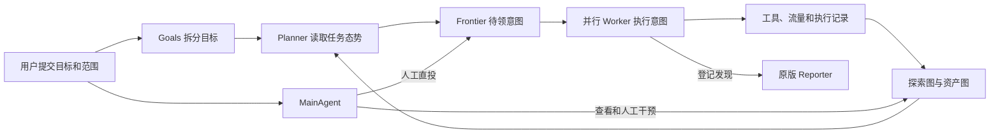
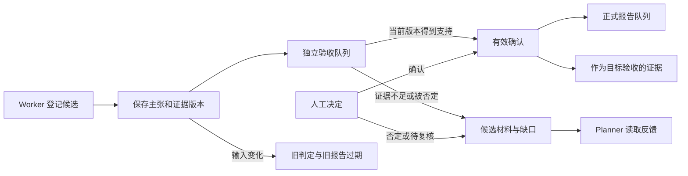

# 从 ARTEX 到 ARTEX PM v0.5｜多智能体渗透测试的架构与改造记录

我在 ARTEX 上做二次开发时，一类问题反复出现在漏洞记录里。Worker 确实发出了请求，也确实收到了响应。Reporter 有足够的材料写出一篇像样的报告。但响应只证明了某种行为存在，报告却进一步声称可以越权或窃取数据。还有任务用证据不足的发现证明目标达成，引擎随即结束了整个任务。一次证据判断偏差，可以沿着报告和调度两个方向传下去。

ARTEX 是 Autumn-27 及贡献者开发的。后文的 v0.4 和 v0.5 是我维护的 **ARTEX PM** 分支版本，沿用 AGPL-3.0。文中的复现示例以本地隔离环境为背景。 [ARTEX PM 项目](https://github.com/V1ll-V/ArtexPM)

AhnLab ASEC 对 ARTEX 做过两项受控实验。一项从 Web 服务的文件上传功能出发，验证了单台主机上的程序执行。另一项从暴露的 ActiveMQ 服务开始，观察到测试任务继续利用初始结果，推进到测试网络中的多台主机。两项实验都从「测试目标、允许范围、预期结果」出发，执行路线随工具实际发现的服务和可用条件而变化。 [AhnLab ASEC 的架构分析与复现实验](https://asec.ahnlab.com/en/95845/)

## 原版 ARTEX 如何组织一次测试

ARTEX 的服务端是 Go 单体，Next.js 静态前端可以内嵌到可执行文件里。服务端通过 HTTP API 提供任务和资产操作，通过 SSE 推送执行进度。PostgreSQL 保存任务、图节点、资产和执行活动。用户打开任务页面时，可以在同一份任务下看到 Planner 派了什么、哪个 Worker 领走了、调用了什么工具、结果写回了哪里。

模型对话、工具调用、权限检查及上下文管理由 Go SDK Norma 提供。可以把它理解成执行模型循环的底座。一次模型返回可以包含文字，也可以包含一个有结构的工具调用。框架解析参数、检查权限、执行工具，再将结果送回下一轮模型。ARTEX 在这套循环上加了安全测试领域的工具和状态，例如读任务范围、创建意图、登记证据与请求人工审批。Planner 和 Worker 由同一个服务进程调度，角色由提示词、工具集和任务上下文区分，可以复用同一套模型配置。

| 角色 | 在一轮测试中负责什么 |
| --- | --- |
| **Goals** | 把用户写下的任务目标拆成可以验收的子目标，提取用户明确给出的域名、地址等测试范围。 |
| **Planner** | 从探索图、资产范围、覆盖情况和 Worker 的产出判断下一步。只在有可执行方向时向意图队列派活，也可以结束本轮等待结果。 |
| **Worker** | 从队列领取一条意图，在其上下文中调用 Bash、HTTP 等工具，写回资产、事实、发现及执行活动。引擎可以并行运行多个 Worker。 |
| **MainAgent** | 用户与任务交互的入口。它可以查询进度、读取执行记录，按用户指示调整在跑的意图或直投一次性检查。 |
| **Reporter** | 原版已经有的报告角色。默认触发器会在 `report_finding` 登记后调起它，读取漏洞节点及关联流量，再生成或更新 Markdown 报告。 |

### 一条意图怎样从派发走到执行

用户先给出目标、资产和约束。Goals 从文字中提取明确指定的范围，再把交付目标写入探索图。对于「验证测试环境中的权限隔离」这样的要求，目标是要回答的安全问题。Planner 可以派出的意图则更具体，例如「用两组已提供的测试身份建立同一接口的正常响应基线」。一条意图可以携带优先级、目标资产和上游线索，Worker 领到时会把这些信息装进本轮上下文。

引擎维护 Planner 循环和多个 Worker 循环。`frontier` 是探索图里处于待领取状态的意图集合，按优先级和编号排序。多个 Worker 可以读到同一个候选，真正的领取在数据库里用带条件的更新完成。只有仍处于待领取状态的那一条能被转成运行中并写入执行者。意图结束时会留下状态和过程记录。例如已经完成、卡在环境依赖、运行到一半耗尽预算，都对应不同的后续处理。下一轮 Planner 可以读取实际执行过程，决定接着做、换方向或等待用户补充条件。

Worker 完成、登记发现或用户恢复任务都会发出唤醒信号。短时间内的多个信号会合并成一轮规划，另有心跳兜底。唤醒本身没有派活义务。如果前置条件还在执行，Planner 可以先结束本轮。两个互不依赖的接口验证可以并行，依赖前序响应的新验证则应等事实写回再派。这里的并行单位是意图，模型之间通过系统记录交换上下文。

### 双图为什么比一段长对话更适合协作

**资产图**回答「这次测到的是什么资产」。它跨任务共享，保存根域、子域、IP、服务、应用和端点，以及归属公司与关联关系。程序负责归一化和去重。任务范围从这份资产库划出本次允许、需要关注的部分。

**探索图**回答「这次为什么测这个方向，最后得到了什么」。它按任务隔离，用 `goal`、`intent`、`fact`、`finding`、`hint` 等节点记录目标、待做事项、观察与结论，用边保存派生、产出和证明关系。两张图通过 `exploration_anchors` 关联。同一个端点可以在多个任务中出现，每个任务的意图、证据和结论分别保留。覆盖图也可以据此显示范围内哪些资产已经有探索活动。

比如「这个服务暴露了一个读取接口」属于可以被后续意图引用的事实，「低权限身份读取到其他账号的数据」则是带有安全判断的发现。探索图可以记录哪个意图产生了事实，哪个新意图从该事实派生，以及哪份材料被用来证明目标。资产图提供被测对象的身份，探索图保留这次测试中的因果顺序。在任务覆盖图上点到一个资产，可以顺着锚点回查测试过它的意图。这种覆盖反映的是可见的探索记录，具体检查深度仍要看执行证据。

图节点适合保存值得长期引用的结论，但 Worker 的过程里还有没来得及归纳的细节。原版允许用 `search_all_worker_traces` 在同任务的其他意图里搜索，再用 `get_worker_trace` 拉取命中步骤。后来的 Worker 可以查看之前实际用了哪个会话、收到什么业务错误、在哪一步受阻，减少凭摘要重跑整条路径。

Planner 每次被唤醒都开一轮新的会话。它把需要串行推进的步骤放在按探索任务维护的 `TodoStore` 里，后续唤醒时把清单带入新会话。这个待办在运行中的 Planner 实例内跨轮共享，探索事实和执行活动则写入数据库。对于存在前置条件的步骤，提示词要求等待相应事实出现，再派下一条意图。

因此，系统实际有三种粒度的记忆。图里保存可以被后续规划稳定引用的结论，执行记录保留结论形成前的工具输入和输出，Planner 待办保存当前正在追的步骤。拿到一个新响应时，Worker 可以先把它留在过程里。真正值得复用的观察再写成 fact，下一轮规划只需读取与当前方向相关的部分。若事实写得太强，例如把「没有看到响应差异」归纳为「确认使用参数化查询」，这个错误也会被持久化并带进后续轮次。后面不少改造就是围绕如何校正这类共享状态。

### 真实工具、审批与流量怎样配合

原版容器提供 curl、nmap、DNS 查询工具以及 Playwright 相关能力。Worker 可以通过 Bash 运行命令，也可以使用结构化工具。Skill 提供某类工作的方法与上下文，MCP 可以扩展可调用接口。执行权限、审批和模型工具描述是不同层次。工具是否可见决定模型能否直接发起调用，执行前的拦截规则再按工具与参数处理允许、拒绝或人工审批。任务文本中的范围为规划和覆盖计算提供信息，具体的执行限制还要落实到工具与拦截配置。

启用流量代理后，经代理的请求和响应可以留存，并作为漏洞的复现证据。工具回合中的 stdout、stderr 和代理留存的 HTTP 记录也有不同用途。前者能说明命令运行了什么、哪里报错，后者能直接检查目标返回的业务内容。比如工具显示请求状态码为 `200`，仍要看正文里是返回了对象，还是提示权限不足。

Google Threat Intelligence Group 与 Mandiant 在另一份针对真实事件的调查中，记录过使用 ARTEX 的密集试探、出错后调整动作，以及并发执行可能互相影响的情况。这些观测和 ASEC 的实验环境不同。对工作流设计而言，它们都说明查看实际命令、工具输出与目标响应的重要性。只看模型最后的自然语言总结，很难知道中间哪些动作真正成功。 [Google Cloud 的 ARTEX 事件调查](https://cloud.google.com/blog/topics/threat-intelligence/artex-and-friends-enter-agentic-offensive-frameworks/)

### 从攻击面清单到可复现的证据

早期的全流程任务里，我用 S1、S2、S3三个阶段 描述预期的交付。先梳理攻击面，再对有价值的线索验证，最后复现和整理证据。这些阶段来自任务目标。引擎实际调度的是意图，Planner 可以在新事实出现后回到前一步，也可以在两个方向互不依赖时并行执行。

在侦察阶段，Worker 把探到的服务和端点写进资产图，把对应的响应和观察写进探索图。后续意图从锚定资产和已有事实接着查。启用流量记录时，HTTP 请求及响应可以通过记录代理留存，并与漏洞证据关联。Planner 据此选择需要验证的方向。一次发现的复现条件、成功响应和对照响应，最终可以从图中的节点追溯到相应的执行步骤。

举一个虚构的授权测试例子。任务要验证某个接口是否隔离两个测试账号的数据。Goals 登记接口和验证目标，Planner 先派一条意图建立正常基线。Worker 用账号 A 读取 A 的记录，再用账号 B 读取 B 的记录，把响应和对象归属写回。Planner 等这些材料齐备，再派一次跨账号读取的对照。如果 A 能读取 B 的非公开对象，候选主张就可以限定在这个端点、这两个已知角色和可重现的读取行为。遇到匿名请求返回 `401`，它只能回答匿名调用的结果，已经登录的低权限账号仍需要单独验证。这样的任务依赖双图分发上下文，也依赖下游正确解读对照结果。

## 原版存在的 Bug 

下面用脱敏后的现象说明机制，不用这批记录估算模型整体的误报率。

### 观察入库后直接变成确认漏洞

导入快照里，`report_finding` 的必填项包括漏洞类型、严重度和摘要，证据字段可以缺省。`RecordFindingTx` 写入探索图时，直接把 finding 节点设为 `confirmed`。流量绑定能证明请求和响应确实存在，能否支撑漏洞主张仍需要看权限前提、对照和可观察结果。默认 Reporter 由登记事件触发，容易沿用这个确认状态。

| 留存的证据 | 早期记录的问题 | 证据能支持的说法 |
| --- | --- | --- |
| 访问备份文件样式的路径时被 WAF 拒绝 | 工具成功登记了一条漏洞，报告正文却承认没有看到文件泄露 | 这些请求被拦截，文件是否存在无法判断 |
| 多次提交错误验证码，均得到相同业务错误 | 推导出有效验证码可以无限枚举，并按较高危害报告 | 这一组无效输入没有观察到显式限流，有效码及可行性还需要对照 |
| 响应回显请求的 Origin，现有样本只有公开内容 | 报告推断可以跨站读取用户敏感数据 | 确认了响应头行为，带凭据读取敏感响应的链路尚未验证 |

也有观察本身真实、影响描述被放大的情况。例如错误页确实回显堆栈，但当作正常对照的 `200` 响应正文仍然是业务拒绝。复核时要分别回答「堆栈是否回显」「什么条件下回显」「回显了什么信息」。这三个问题的答案可能分别是已证实、待核实和影响有限。

### 人工状态、图状态与复测分叉

原版的漏洞详情可以改处置状态。人工标记误报时，漏洞表发生变化，探索节点仍可能保留 `confirmed`。这样一来，用户在列表看到误报，Planner 的态势摘要仍可能把同一条漏洞记录算作确认发现。旧版已有流量证据版本，能表示绑定的材料发生了变化，但技术判定缺少同样的输入版本约束，新材料不会自动使旧确认失效。

复测也有类似的身份问题。再次调用登记工具通常会插入新记录。同一个端点、同一个根因，初测和复测可能各出一条 finding 和报告。对读者来说它们像两个漏洞，对调度器来说它们又可以被当成两份成果。

### 一条浅层结果提前结束整场测试

原版 `prove_goal` 检查证据是否是可引用的 fact 或 finding，连接 `proves` 边，然后直接把目标标为 `met`。所有已经拆出的目标都变为 `met` 时，Planner 可以返回完成。引擎落库 `done`，随后立刻取消在跑的 Worker。

实际回看中，有授权边界、参数对照等方向还在运行，浅层发现已经满足了剩余目标。另一个样本里，目标拆分只留下了攻击面清单，原任务要求的后续验证没有保留为单独的目标。引擎可以忠实执行「所有已登记目标完成」，却无法从这句话得知原始需求被漏拆。

并发还会放大环境限制。单个 Worker 自己放慢节奏，无法保证其他 Worker 不在同一时刻打到共享的站点或出口。没有测试账号时，反复派发「验证登录后权限」也只会重复得到匿名响应。这些是审计发现的限制，本文的改造没有给全局请求限速或探索覆盖率作完成承诺。

## 第一轮改造让人能复核和纠正结论

我先加入漏洞复核入口。原版的修复复测回答「修复之后还能不能复现」，新增的复核回答「原来的漏洞定性与危害是否成立」。人工可以采纳或覆盖模型建议，把结论记录为确认、误报、影响夸大或无法判断。影响夸大的记录可以给出建议等级和修订后的完整报告，保留复现步骤及 PoC 材料。复核意见可以独立保留，是否同步更新处置状态由操作者决定。

这几个选项来自实际的处理差异。比如错误页确实回显了堆栈，但原报告夸大了泄露内容，复核可以保留观察到的堆栈，改写触发条件和影响。对于只看到一个拒绝响应的情况，则可以记录「无法判断」，等拿到有效测试条件后再复核。保留原报告、复核建议和采纳决定，后来的人就能看懂为什么等级变了。

这一步让错误有地方改，也保留了原判断与修订理由。它的局限是复核发生在登记以后。系统仍有机会在人工打开详情前就使用了旧结论。后续 v0.4 版本的时候把验收前移到报告和目标完成的入口。

## v0.4 版本 ：把候选、验收和收尾变成持久流程

我把 `report_finding` 的产出改成**候选主张**。候选保存触发条件、复现材料和证据引用。验收器拿冻结的材料判断主张是否得到支持、被反证推翻，或还需要复核。它可以接受有证据的较小结论，同时列出未证实的部分。只有当前版本的有效支持判定可以驱动正式报告，Planner 也能读到证据缺口和被支持的范围。

### 一条发现怎样从候选变成正式结论

以隔离环境中那条跨账号读取为例，Worker 的候选可能写「所有同类接口都存在越权」。验收时真正可用的是一个确定的端点、两种测试身份和一组请求响应。正常读取基线能证明接口和账号工作正常。跨账号的成功响应还需要展示返回对象的归属。假如材料只覆盖一个端点，验收可以支持这个端点上的读取问题，把同类接口的推断留在待验证范围。若响应正文只有业务错误，则保留候选和缺口，等待新的对照。

实现上，候选主张、原始复现描述、流量证据、历史决定都会组成验收输入。流量引用可以带上证明、基线或对照的角色，验收时补入可校验的请求和响应正文。它能明确看到「已有正文」「材料缺失」「只提供了摘要」之间的差异。任务开始验收时先固定所用版本，后面追加证据可以产生新版本，进行中的验收依然对应它当时读取的那份材料。

这里的「独立」指单独的验收调用、输入和提交规则。验证和报告各有持久队列，领取任务会产生租约和代次。假设一次验收正在读取版本 7，用户同时追加了新的对照，输入变成版本 8。即使版本 7 的调用先返回支持，提交时也会发现版本已变。报告同样绑定有效判定及对应的输入。重新领取已过期的工作会获得新的租约代次，重启前那次执行的迟到结果也受到约束。

如果只是重新提交同一份主张和材料，或改变材料的显示顺序，系统按内容判断是否发生了实质变化。复测指定已有的 `finding_id`，把材料追加到原发现。这样一条发现可以拥有多次验证和多版结论，列表中的数量仍按发现计算。需要重审时，也可以用已有材料重新排队。

人工决定有持续优先级。自动验收正在跑时，如果操作者确认或否定，旧验收结果即使晚到也不能覆盖它。人工清除决定后才交回自动判断。列表、探索图和导出共用有效判定口径，处置状态继续表达待处理、已处理等业务含义。迁移时保留历史报告和复核，旧发现按历史记录处理。归档格式 v4 保存候选主张、决定、验收和报告运行，恢复后再重新安排待办。

### 目标验收与漏洞验收各自回答什么

一条漏洞成立，回答的是某个安全主张得到多少证据支持。任务目标达成，回答的是用户要求的交付有没有完成。例如「梳理授权范围内的端点并说明未覆盖项」可以由资产、测试事实和记录证明。「复现某个指定漏洞」才需要有效的漏洞证据。`prove_goal` 改为提交证据供验收，由持久化结果决定目标是否满足。此时过期的漏洞判定、被否定的事实或失效的证明关系都需要重新检查。Planner 可以提出证据与理由，最终状态由服务端提交。

全部目标满足后，协调器先停派发和领取，给在跑的 Worker 有限的时间保存结果，再提交终态。比如另一个 Worker 已拿到响应，正在写回事实，收尾阶段允许这份结果落下来。到了收尾上限，系统会取消剩余执行，任务原定的截止时间仍用于判断超时。运行代次用来防止已被暂停、恢复或删除的旧协调器把任务误写为完成。因目标达成而停止的意图记录为 `stopped`，预算耗尽的则记录为 `exhausted`。用户回看报告时，可以区分「完成后停止的方向」和「预算内只查到一半的方向」。

### 上线后遇到的两个反作用

第一个发生在启动时。v0.4 初版把整套验收就绪检查和任务启动绑得太紧。旧数据库的默认报告触发器可能缺少可证明的来源，迁移会保留它并要求人工核对。此时创建接口仍返回成功，因为任务确实写进了数据库，但界面没有告诉用户引擎被阻塞。我先让任务列表和详情显示「已保存但未启动」及原因。随后在 v0.5 把**可选的漏洞自动验收和报告**从任务启动、继续、目标证据判定和收尾中拆开。

「系统 → 候选验收」后来补上了两个模型选择入口。**验收模型**负责读证据、判断主张，返回结论、适用范围及关键缺口。**报告模型**拿到被支持的结论和材料，再组织成读者可以复现的报告。两者都可复用已有的任务或系统模型配置。缺少报告模型时，对应报告任务等待，Worker 和候选验收有各自的运行条件。CTF 的 WP 走后文的证据生成流程。

第二个发生在报告侧。一批发现长期停在待复核状态，用户看不到正式报告，却已经积累了相当多的模型调用。检查队列后发现，当时根本没有「通过验收」的事件，Reporter 自然没有正式报告任务。其中一个任务账本有 1,980 次 Worker 调用、298 次 Planner 调用。这是单个历史任务的计数，不能拿来计算优化后的普遍节省比例。大量重复请求发生在关键对照拿不到、模型继续尝试补齐材料的情况下。

我加了**候选材料报告**，直接从已有主张、复现材料和证据缺口生成可复制、可导出的 Markdown。已经掌握的内容可以立即交付，正式漏洞报告依旧跟随有效验收。候选材料报告由现有字段组装。打开详情、复制或导出都无需为同一份材料发起一轮写作请求。

模型开销也分原因处理。验收提示只追问影响结论的关键证据，允许有充分证据的较小范围先成立。下一轮 Planner 先查本地已有记录，再决定是否需要取得新材料。Reporter 明确返回缺证据时，系统记录这个结果并停止同一份输入的自动重试。等输入真的变化，再产生新的报告任务。网络等临时故障仍走原有重试，因为同一份输入在服务恢复后可能正常处理。提交给模型的证据改用紧凑 JSON，保留字段。

还有两个小问题影响实际使用。Windows 上证据正文写入后，对目录执行 `Sync` 会失败，后来改成 Windows 的写穿透移动方式发布文件，保留文件校验和真实 I/O 错误。发现列表上的长文本曾与验收徽标重叠，也调整了布局。

## v0.5 给 CTF 单独定义执行和完成条件

通用渗透任务的交付包含约定范围、测试结果、证据和未覆盖项。CTF 任务通常只需要解出题目、交付 Flag，并能复现求解过程。把两者放进同一套默认提示词后，CTF 即使已经拿到候选，也可能继续补资产、跑探针或走漏洞报告流程。这个现象在实际使用中最明显的代价是，用户已经可以去题目平台提交，模型还在为后续流程花回合。

CTF 继续使用 Goals、Planner、Worker 和 MainAgent 的分工，每个角色都换成专用的解题提示词。Goals 默认只建立用户要求的最终交付目标。静态分析、下断点、写脚本和复现都是可选的执行步骤。Planner 每轮默认只新增一条必要意图，已经有工作在推进时可以等待。Worker 找到候选就交接，MainAgent 把答案和来源呈现给用户。只有 ELF 附件的题目也能走这条流程。

### 附件随任务走，执行按意图隔离

我为新建任务加入 `pentest` 和 `ctf` 模式，CTF 还可选 Web、Pwn、RE 或自动分析。附件正式绑定任务，记录用途、SHA-256 和识别结果，支持受限 ZIP 解压。Goals、Planner、MainAgent 读取当前附件清单，Worker 以意图启动时的输入快照执行和续跑，方便复现当时到底拿了哪个文件分析。

一题 Pwn 可能同时给主程序、libc、动态加载器和源码。附件角色让模型知道这些文件的关系，ELF 或 PE 识别可以提前给出格式和架构信息。假如测试中途换了一份 libc，新意图会拿到更新后的清单。原先的日志仍指向旧版本，用户可以区分「旧环境下观察到的地址」和「当前附件下还需重新验证的结果」。输入版本随执行和候选一起保存。

CTF 的 Bash、文件操作和专用分析命令交给独立 `ctf-runner`。执行容器按任务、意图和输入版本划分工作区，原始附件只读，产物写入工作卷。工具容器以非 root 运行，根文件系统只读，并设 CPU、内存、进程和命令时限。只有执行器控制 Docker，CTF 智能体的工具装配也会排除外部 MCP。通用任务保留原来的工具装配和规划方式。

应用在第一次调用时把固定输入和工作文件交给执行器。后续调用可复用同一意图的工作卷，前一轮生成的调试脚本可以直接交给下一轮继续用。命令超时由执行器终止进程，服务仍记录这一轮为何结束。记录里有执行 ID、输入版本、工具镜像、退出码和输出，WP 可以直接引用这次结果。应用镜像与工具镜像分别构建，增加 UPX 这样的依赖时可以只更新工具镜像。

### Web、Pwn 和 RE 实际怎么跑

**Web 题**常从题目给出的 URL 或源码附件开始。`ctf_http` 接收结构化的方法、查询参数、表单、请求头和正文，在同一题目执行容器内发出请求。它能保留同一意图的 Cookie，让 Worker 连续验证需要会话的步骤，并保存响应头、响应正文、状态码和最终 URL。下一次请求前会清理上次响应文件。连接失败时，旧正文中的 Flag 不会被误登记成这次的产出。这个细节也区分了「服务返回了 HTTP 错误页面」与「请求根本没有完成」。

例如一题需要先建立会话，再访问题目中的结果页面。Worker 可以用第一条响应确认会话建立，用同一意图的 Cookie 发出第二条请求。若第二条实际跳回登录页，状态码和最终页面会反映这一点。若响应正文确实出现候选，用户在 WP 里就能看到它来自哪次请求。对于只给源码的 Web 题，也可以先定位题目入口和数据流，再决定是否需要发请求。

**Pwn 题**先识别 ELF 架构、加载器和保护选项，再决定如何验证程序行为。`ctf_gdb` 以脚本方式启动 GDB，可以在输入处理函数下断点，读取寄存器、栈和反汇编。`ctf_python` 可运行和保留 pwntools 脚本，用于启动本地程序、组织字节输入并检查输出。镜像还提供 gdbserver、ROPgadget、ropper 等工具。当前动态调试入口是 GDB 批处理，适合把一次断点验证完整写进执行记录。Pwngdb、Pwndbg 目前未预装。

我用本地合成的 ret2win 样例验证过这条链路。程序里有一个存在栈越界的输入函数和一个打印答案的 `win` 函数。集成测试先编译样例，用 GDB 命中输入函数的断点。之后 pwntools 脚本构造测试输入，把执行导向 `win`，并读到程序实际打印的 Flag。系统保存这份脚本和执行输出，再生成候选。这个测试把「镜像里有 pwntools」和「脚本真能驱动程序、产出可复核结果」区分开来。

**RE 题**可以用无界面 Ghidra 导入样本，抽取关键函数伪代码，用 radare2 查字符串或交叉引用，再把检查逻辑整理成 Python 脚本。遇到适合求解的约束时，可以调用 Z3 或 angr。求出的输入仍可交给原程序验证。镜像新增的 Linux 版 UPX 可以先解包标准 UPX 壳，再把解包后的文件交给分析工具。Windows PE 已有格式识别、静态分析和标准 UPX 解包的路径，依赖 Windows API 的动态调试和复杂脱壳则需要另行接入执行环境。

合成样例中也有一个很小的 RE 检查函数。它把一个输入字节与 `0x55` 异或，再与 `0x12` 比较。Ghidra 导出这个函数后，求解脚本可以把比较写成等式，算出满足条件的字节。这个例子里的等式可以直接手算，集成测试还实际调用了 angr 的约束组件。对于较长的校验链，可以沿同样的方式把一段伪代码转成约束，最后以程序的实际响应核对解是否有效。

### 找到候选后先交给用户验证

候选 Flag 来自真实执行输出，或由模型引用某次执行中确实出现过的值提交。字符串匹配只建立候选。例如题目页面、程序样例或命令回显可能包含看似正确的值，正确性要靠题目平台验证。当前输入产生待确认候选后，系统停止自动派发和领取，下一次自动模型请求边界用本地交接说明收尾。已经在途的命令可能完成。用户可以直接复制 Flag 去提交，否定全部待确认候选后再继续解题。

这里做了提示词和执行层两部分。提示词告诉角色发现候选就停，执行层在派发、领取、调用新工具和发出下一次自动模型请求前读取候选状态。比如一次求解脚本返回 Flag，系统先写日志、登记候选，然后在下一轮模型请求前生成交接消息，直接给出答案和来源执行。于是「请再总结一次」也无需访问模型。若题目平台否定该值，系统保留此前的决定。相同输入下，同一个已否定的值再次出现在日志里，也不会反复把任务卡回待验证。

我还修了一次「对话安静了，任务仍在运行」的问题。旧确认按钮只保存候选接受状态并唤醒 Planner。如果还有一个未结束的辅助目标，任务仍可以是 `running`。现在 **验证正确并完成任务** 会在一个事务里确认当前输入的答案、写入完成时间、停止剩余意图并作废旧目标验收任务。未继续执行的目标标为放弃，审计记录保留原因。多 Flag 或仍有其他交付的题目可以选择「仅确认，保留其他目标」。撤销确认或更新输入会使相应完成依据失效，任务重新打开并暂停。

### WP 怎样从执行记录生成

WP（Writeup）由当前证据确定性生成。报告开头给出题意、输入与解题状态，接着按执行记录展示命令、输出和求解脚本，最后列出候选是否经用户确认。换过附件的任务会保留历史执行，并标明它们所用的输入版本。输入和证据不变时，可以复用已生成的版本。未确认的题目有阶段报告，确认之后也无需另跑报告模型。归档格式 v5 增加 CTF 执行和候选，文件包保留附件及证据，恢复兼容旧格式。

### 一次在调用工具之前就失败的兼容问题

有一次 Worker 刚开始就报 `model_error`，底层提示 `Invalid schema for function 'ctf_tools': null is not of type "object"`。日志显示没有发出工具调用。原因是无参数工具的 schema 被编码为 `"properties": null`，严格校验的模型接口在接收工具列表时就拒绝了请求。我把空属性标准化成 `{}`，也处理了数据库中保存的旧覆盖配置，并用模拟接口验证 Anthropic 和 OpenAI 两种格式。这个例子里，重派 Worker 或改题目提示词都会重复撞上同一个请求格式问题。
