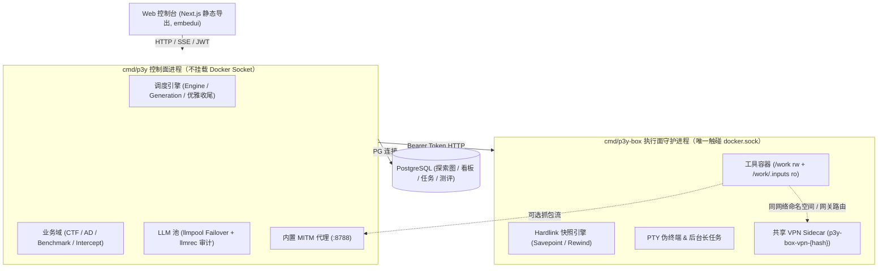
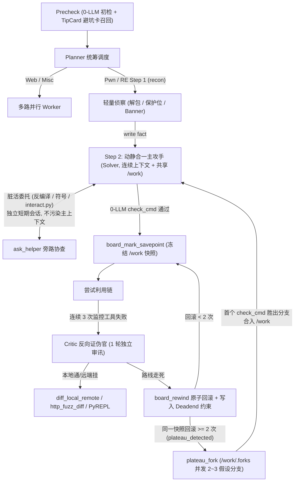

# 从 ARTEX PM v0.5 到 P3Y v0.91｜单模型攻坚、多智能体编排与自动化测评的架构演进

上一篇记录写到 ARTEX PM v0.5 时，系统已经能把「证据候选」和「正式验收」拆开，也能把 CTF 题目放进 `ctf-runner` 容器里跑通 Web、基础 Pwn 和 RE。

但在后续把它长期放到真实硬题、Attack-Defense 混战以及全自动多平台测评里压测时，另一类更深的问题暴露了出来：

- **机械切片在有状态任务里反而是负收益**。Web 侦察拆成多个并行 Worker 可以提速；但放到 Pwn 或强状态 RE 题里，强行按「静态分析 Worker → 动态调试 Worker」切片，往往意味着上下文断层、工作区重复解压附件、同一份 libc 被下好几遍。
- **长上下文一旦积累过多失败输出就会产生惯性**。没有外置结构化记忆和读档点时，单模型很容易顺着一条错误假设不断「微调参数再试一次」，直到把整个对话窗口和预算耗光。
- **全自动测评场景放大了基础设施的隐性缺陷**。多题并发共用同一个 `.ovpn` 证书互踢、双栈环境下优先走 IPv6 导致建连超时、单题超时重排后完全忘掉前一轮已经做过的分析。

从 v0.5 演进到 **P3Y v0.91** 的核心工作，就是重做控制面与执行面的隔离结构，重写面向单题攻坚的多智能体协作边界，并补齐自动化测评和 AD 攻防闭环。

---

## 一、总体架构：控制面、执行面与状态持久化解耦

相比早期把 Docker 调起逻辑和控制面混在同一个视角下，现在整个系统明确切分成三层：



### 1. 控制面无 Docker 权限，任务工作区直挂宿主机

主进程 `cmd/p3y` 不再直接碰 Docker。所有容器启停、文件归档、命令超时终止和交互式 PTY 都通过令牌鉴权的 `cmd/p3y-box`（`ctfrunner`）完成，主服务与执行器可以分别部署或独立升级工具镜像（`Dockerfile.ctf-tools`）。

早期版本向容器执行命令时需要把工作文件反复打包传给执行器；现在的做法是按任务目录直接 Bind-Mount：

- **主工作区 `/work`（读写）**：同题目的不同阶段、主攻手、旁路助手之间直接共享同一块持久目录，生成过 `interact.py`、patch 好的 libc 或反编译中间结果后，后续环节无需重新拷贝或解包。
- **原始附件 `/work/.inputs`（只读）**：题目原始附件与后续替换的新输入版本以只读挂载进入容器，防止智能体在调试过程中误改或覆盖原始样本。

### 2. 按配置哈希共享的 VPN Sidecar

接入需要内网打靶的测评平台（如 TSecBench）时，原先按「任务 ID」一对一创建 VPN Sidecar（`p3y-box-wg-<taskID>`）。这在并发评测时立刻暴露出一个问题：同一场测评的多道题共用了同一份 `.ovpn` 客户端证书，后上线任务的 Sidecar 拨号连上服务端后，OpenVPN Server 会判定重复客户端并给先前的 Sidecar 下发：

```text
Halt command was pushed by server ('Connection established by a new client, please reconnect to server or contact the administrator')
```

结果就是几个并发题目反复互相踢掉线。

现在的处理方式是**按配置内容的 SHA-256 哈希共享隧道 Sidecar**（`ctfrunner/vpn_engine.go`）：

- 容器命名改为 `p3y-box-vpn-<hash[:16]>`，由 `lockVPNHash` 串行化初始化；
- 同一份 `.ovpn`（OpenVPN）或 WireGuard 配置下的多个并发任务共用同一个健康隧道容器，不再重复拨号；
- 单个任务清理容器时，引擎先检查同 `p3y.box.vpn` 哈希下是否还有其它活跃工具容器，全部退出后才回收共享 Sidecar；
- 建网时遇到 Docker 子网冲突（`Pool overlaps`）会自动顺延候选网段，平台 HTTP 客户端也强制 IPv4 优先拨号，避免无 IPv6 路由环境卡死。

---

## 二、通用多智能体引擎与记忆控制设计

在引擎外层，P3Y 沿用了「事件驱动调度 + 图谱持久化状态」的基本思路，但围绕**上下文膨胀**和**跨任务接力**做了几层关键约束。

### 1. 图谱黑板 + L1/L2/L3 渐进式看板

除了原有的探索图节点（`goal`、`hint`、`intent`、`fact`、`finding`）和资产图之外，系统在任务执行层补充了更轻量的共享状态看板（`board_items`）：

| 节点类型 | 语义 | 上下文预算控制 |
| :--- | :--- | :--- |
| `fact` | 已观察到的客观线索（端点、偏移、保护位） | 严格区分 L1（Title）/ L2（Summary）/ L3（Detail）；概览只注入 L1+L2，必要时由工具 `board_read_detail` 按需展开 L3 |
| `step` | 正在推进的小步验证或短冲刺项 | 可挂载在某个 Savepoint 下归类追踪 |
| `savepoint` | 经过确定性验真后的里程碑与容器快照引用 | 携带真实 `SnapshotID` 与回滚计数 |
| `deadend` | 某次读档回滚后沉淀的负向排除约束 | 挂在对应 `savepoint` 下，明确标出“什么路径不要再试” |

这样一来，无论是单任务内的跨意图接力，还是后续把任务关联给新任务继承，模型都不必靠滚动长对话去翻几十步以前的工具输出。

### 2. 冷图折叠（`coldgraph`）与双路上下文治理

任务运行轮数拉长后，哪怕探索图也会变得庞大。为了不让过期分支撑爆 Planner 和 Worker 的概览窗口，引擎引入了两层自动收拢：

- **冷图摘要折叠（`agent/coldgraph.go`）**：纯图算法层在计算连通块时主动剥离已生成的 `covers` 视图边，只依据真实的因果关系（`yields`、`derived_from`、`spawns`）判断节点冷热。当一片互相关联的非活跃节点连续超过 `R = 6` 轮 Planner 唤醒未被引用，且连通块大小达到 `K = 2`（含同父节点下沉睡孤立节点的抢救聚合）时，系统将这片旧探索枝干折叠成一个紧凑的 `cold_digest` 摘要；需要核实细节时再用 `expand_digest` 展开。
- **Worker KV Cache 友好设计与可选 `noa` 压缩**：Worker 把所有变更频繁的动态态势（本轮意图说明、看板概览、输入清单）全部放在首轮 `user` 消息中，保证 `SystemPrompt` 严格静态，从而最大化复用各 LLM 厂商的 Prompt / KV Cache；此外也预留了实验性的 `noa` 持久化上下文归档压缩开关。
- **异步旁路问答（`sidequestion`）**：人工在任务详情或对话侧发起临时追问时，通过旁路上下文预算机制直接基于已捕获信息响应，无需打断或污染后台正在跑的探索状态机。

### 3. 基于 `SourceTaskIDs` 的只读血缘继承

在任务关系设计上，系统区分了纯父子指针（`parent_ref`）与内容血缘（`source_task_ids`）。一个新建任务可以在创建参数里传入最多 `MaxTaskSourceCount = 8` 个直接来源任务（`db/exploration_sources.go`）：

- 源任务必须是直接关联（不递归展开“源任务的源任务”，防止血缘树指数爆炸），且支持源任务被删除时自动解除只读视图；
- 新任务在态势概览中会直接拿到前序任务的 `goals`、`hints`、`facts`、`findings`、终态 `intents` 与 `cold_digests`（统一带 `inherited: true` 只读标记），既能调用 `node_detail` 和 `activity_detail` 追溯前人踩过的坑，又不会误改前序任务的状态。

---

## 三、CTF 单模型攻坚的多智能体编排演化

这一轮变化最大的地方在 CTF 解题链路。实践证明，对于 Pwn 和复杂 Reverse 题目，“把所有阶段拆成互不认识的独立 Worker 队列”效果并不理想——上一个 Worker 刚摸清堆布局、交互协议，退出之后下一个 Worker 还得花 10 轮重新把二进制读一遍、再自己重写一套 `pwntools` 脚本。

因此 P3Y 在 CTF 模式里对不同题型做了分化编排：**Web / Misc 维持横向多路并行探索**，而 **Pwn / Reverse 收敛成“前置短侦察 + 单主攻常驻 + 旁路协查 + 快照回滚树 + 反向证伪”的攻坚闭环**。



### 1. Phase-0 零消耗初检与 `TipCard` 闭环

任务真正唤醒 LLM 之前，先由 `ctf/precheck.go` 执行一轮确定性扫描：

- 计算所有附件的 SHA-256、识别文件类型，利用 Go 原生 `debug/elf` 与 `debug/pe` 直接抽出架构与 NX / Canary / PIE / RELRO 等保护信息；从题干抽取远程 URL、`nc host port` 与目标地址；
- 用提取出的标签和题型去匹配历史避坑卡（`TipCard`），连同初检汇总表直接写入任务启动上下文，避免模型开局白白浪费几轮执行 `file` / `checksec`；
- 任务通关验收之后，系统触发 `CrystallizeTips`（`ctf/tips_crystallizer.go`），把被验证走通的路径、踩过的 `Deadend` 与沉淀工具抽成新 `TipCard` 供后续跨题召回。

### 2. 工具包延迟解锁与 `ask_helper` 旁路协查

如果一上来把 Binary、Web Fuzz、Pcap 解析、MCP 等四五十个工具 schema 全塞给模型，不仅浪费 Token，还会干扰工具选择。系统通过 `DeferredInfo` + `UnlockSet`（`agent/assembly.go`）在运行时按题型裁剪初始暴露的工具包，需要跨领域能力时由主攻手调用 `ctf_unlock_toolpack` 按需解锁。

更关键的是把“重输出、高噪音的局部任务”剥离出去。主攻手遇到需要海量反编译分析（比如 Ghidra 跑大二进制导出几十个函数伪代码）、海量字符串与 Gadget 搜寻、解析大流量包，或者需要写一份稳定的 `interact.py` 交互框架时，调用 **`ask_helper`**（`agent/helper.go`）：

- 系统在同一个容器与 `/work` 上下文中启动一个受 `max_turns`（默认 6 轮、上限 8 轮）约束的短生命周期 Helper 会话；
- Helper 仅保留分析与文件读写能力，刻意移除了 `board_mark_savepoint`、`board_rewind`、`plateau_fork`、`ctf_submit_flag` 和嵌套 `ask_helper`，防止越权更改状态树或误提假答案；
- Helper 把可用脚本写到 `/work`（可选调 `board_save_kit` 入库成套件），在结束时只向 Solver 带回一份压缩到 1200 字以内的接口/偏移摘要，随后彻底销毁自身对话上下文。

### 3. `Savepoint / Rewind` 时光倒流状态树与 `plateau_fork`

为了让主攻手敢试错而不把工作区搞乱，P3Y 把“状态存档”做成了一等工具（`agent/board_tools.go`、`ctfrunner/savepoints.go`）：

1. **必须先过确定性门禁才能存档**：模型调用 `board_mark_savepoint` 时必须提供一个 0-LLM `check_cmd`（例如用 `python3 -c 'import interact'` 验证脚手架可用，或者验证某个地址泄露脚本稳定跑通）。只有容器执行 `check_cmd` 返回 `exit 0`，`p3y-box` 才会冻结一份 `/work` 硬链接快照，并在看板中创建 `Savepoint` 节点。
2. **原子读档 + 负向约束**：一旦当前利用路线走入死胡同，模型（或操作者在控制台）调用 `board_rewind` 选择目标 `Savepoint`。工作区立刻原子恢复到该快照的干净状态，同时看板会在该存档点下强行挂一条 `Deadend` 记录（标题与失败原因），避免自己或后续接力的模型重复尝试已经证明行不通的手法。
3. **停滞触发并发竞争分叉**：同一个 `Savepoint` 连续被回滚达到 `2` 次时，工具返回值直接提示 `plateau_detected = true`。此时可以调用 `plateau_fork`（`agent/plateau_fork.go`）：基于这个快照在 `/work/.forks/<fork_id>/<branch>` 下复制出 2~3 个彼此隔离的工作子目录，由多个受限子协程并发验证互不依赖的假设路线（比如同时试 `ret2libc`、`SROP` 或不同编码绕过）。只要某条分支的 `check_cmd` 率先跑通 `exit 0`，其余分支立即取消，胜出分支的产物自动合回 `/work`，其余分支的失败结论直接沉淀为 `Deadend`。

### 4. 对抗证伪官（`Critic`）与神经符号对照工具

大模型在 Pwn / 密码 / Web 盲测中最常见的顽疾是陷入沉没成本循环：哪怕服务端连续返回 EOF 或 403，它还是相信「再加 8 字节偏移就能通」。

P3Y 在 Worker 的工具执行 Hook 链上直接挂入 **`ctfCriticHooks`**（`agent/critic.go`）：

- 它持续监听高试错倾向的工具（`Bash`、`ctf_python`、`ctf_gdb`、`http_send`、`ctf_http`、`http_fuzz_diff`、`py_repl`、`ctf_probe_target`、`ctf_session_send`、`board_mark_savepoint`）；
- 一旦任意组合**连续失败 3 次**（包括返回非 0 退出码、JSON 里带 `error`/`passed=false` 或 traceback 崩溃特征），下一次普通重试会被钩子直接拦截；
- 系统立即以当前失败样本做 Dossier，调用 1 轮独立无包袱的 **`Critic`** 模型做 350 字以内的**反向证伪分析**：指出当前最可能错的前提（如误判 glibc 版本去掉了 `__free_hook`、栈未 16 字节对齐触发 `MOVAPS`、EOF 时机与缓冲区截断）、强制给出一个最小对照证伪实验，并要求用枢轴工具转向；
- 只有 **枢轴工具**（`board_rewind`、`plateau_fork`、`diff_local_remote`）以及工具内部自修正逻辑能绕过拦截继续执行。

配套的神经符号工具组（`agent/neuro_tools.go`、`ctf/pyrepl.go`）则负责把模型从“靠眼力和心算”里解放出来：
- **`diff_local_remote`**：在「本地打通但打远端就挂」时，一键在统一条件下并行跑本地和远端目标，自动对齐退出码、耗时、泄露的十六进制地址特征、`EOF/SIGSEGV` 信号与差异文本，直接给出排查线索；
- **`http_fuzz_diff`**：针对 Web 接口批量注入多种 Fuzz Payload 后按状态码、响应长度与特征自动聚类，替代大模型手写几十次单发请求；
- **`PyREPL`**：在任务沙箱内常驻一个持久化 Python 进程，做长程 `z3` 约束求解、密码学大整数运算或复杂状态编码推导时无需每次重起进程加载模块。

---

## 四、面向真实赛场的另外两条专用编排链路

### 1. Attack-Defense 四引擎自治攻防（`p3y/ad`）

针对需要一边防御自己靶机、一边定时收割全场 Flag 的 AWD/AD 赛制，系统单独抽出一套零交互优先的后台闭环（`ad/service.go`）：

- **Lead 战术调度**：读取全局武器列表和战况事件流，实时生成可执行的 `easy_first`、`stop_loss`、`salvage_payload`、`verify_patch` 优先级建议；
- **Repeater 周期打靶器**：脱离 LLM 对话循环，由后台确定性调度已注册的利用武器并发或顺次打击全场存活靶机，自动抽取动态 Flag 并可选直交平台，同时对连续失效的靶标做自动熔断；
- **Catcher 流量镜像捕手**：旁路扫描 MITM 抓包和镜像样本，匹配命令注入、SQL 注入、SSTI、文件包含、反序列化与格式化字符串特征，把对手打过来的载荷提取出来反哺己方攻击与防御；
- **Patcher 红蓝双验沙箱**：收到己方源码/服务补丁后，在沙箱里串行验证三件事——补丁确实生效、业务 SLA 连通性检查（`check_cmd` 返回 `0`）、以及已知 PoC 不再能打出 Flag 泄露。

### 2. 多平台零交互自动化测评调度器（`benchmark`）

为了能长时间无人值守对比评估能力，系统在控制面内置了一整套多平台测评调度器（`benchmark/`、`server/benchmark.go`）：

- **三类平台统一抽象**：支持 **TSecBench（REST + `.ovpn` 凭证）**、**CTF2 / DASCTF（MCP）** 与 **Generic MCP（通用 MCP 协议 + 用户上传 `Skill.zip` 注入提示词）**。
- **平台配额与容器自愈**：对接平台实时并发上限，当遇到 `agent_environment_limit` 报错时不会直接把待调度题目全标红，而是主动遍历探测并回收此前中断泄漏的平台靶机（`reclaimOrphanedEnvironments`）；活跃靶机剩余不足 5 分钟时自动调用平台续期。
- **超时/异常自动冷却重排与跨轮记忆继承**：
  - 单题默认时间预算 `5400s`（90 分钟），且可在创建或测评运行中通过 `PATCH /api/benchmarks/{id}` 动态调整并发和超时预算；
  - 题目到达单题预算超时、任务意外终止或平台起容器异常时，自动进入阶梯冷却重排队列（`30s → 60s → 120s`，最多自动重试 3 次），把槽位暂时让给队列中其它健康的题目；
  - 冷却到期后重新创建子任务时，系统通过 `benchmark_challenges.history_task_ids` 自动把这题先前所有尝试过的子任务 ID 传给 `SourceTaskIDs`——这意味着**重排后的新任务直接继承前面轮次已经确认的 `fact`、线索与踩坑结论**，同时 Prompt 明确提醒 AI 以本轮新靶机的实时 IP/端口为准；
  - 测评生成的每道子任务都在「任务」总表中可见并带 `测评 #N` 链接，点击即可完整审计探索图、工具调用、HTTP 流量和 LLM 原始账本。

---

## 五、一些工程细节与真实边界

这段迭代里同样改掉了很多账面上看不出但一跑必踩的坑，比如：
- 从旧版延续过来的“工具参数空属性 schema 编码为 `null`”问题，规范为空对象 `{}` 才兼容严格 OpenAI/Anthropic 校验；
- 多源并发或跨代理环境中，外部宿主机代理环境变量容易干扰内网靶机或本地回环服务连通性，因此在容器/沙箱及平台拨号链路中做了显式清理与代理分流；
- 候选交付分成 `flag`、`exploit_proof` 和 `flag_and_exploit` 三种验收口径，让没有传统 `flag{...}` 字符串、只看“越权提权或状态篡改是否真正生效”的赛题不再误报或死找不存在的字符串。

当然，这套结构也还有一些仍在持续打磨的现实边界：
1. **工作区回滚并不等同于对话时间倒流**：调用 `board_rewind` 会把 `/work` 容器文件和看板约束回滚到指定 `Savepoint`，但当前主攻 Worker 已产生的 LLM 对话窗口不会跟着截断销毁，只能靠追加的 `Deadend` 约束、Critic 干预或派生新的 `plateau_fork` / 重排子任务来切换语境。
2. **并行的物理开销依然由同一套模型池承担**：开启 `plateau_fork`、高频 `ask_helper` 以及评测多并发时，会明显放大对底层 LLM 接口和本地沙箱资源的并发压力，依赖 `llmpool` 的限流退避与多个备用 Profile 链条兜底。
3. **二进制动态调试高度受限于容器底座匹配度**：尽管有了 `ctf_pwn_triage` 和 `diff_local_remote`，当题目依赖特殊内核特性、老版本 glibc 或封闭 Windows GUI 环境时，仍然依赖对应的基础工具镜像补齐环境。

回头看两条演化线，v0.4–v0.5 重点解决了 **“模型声称的结论可不可信”**，而到现在 P3Y v0.91，重心落在了 **“怎么让单模型在复杂环境下不乱上下文、踩坑能回档、跨轮有记忆、以及多角色只在高价值处介入”**。后续如果继续演进，大概会往真正把核心推理链路的状态切换进一步细化（包括回滚时的对话切片策略与更稳定的远程长会话自愈）上走。
